# Amour Partagé: Android app (Flutter)

A calm, private space for two: four tabs, a few cards per screen, and a light and a dark theme (it follows your phone's setting by default).

| | Home | Together | Chat | Memories | Map |
|---|---|---|---|---|---|
| **Dark** | 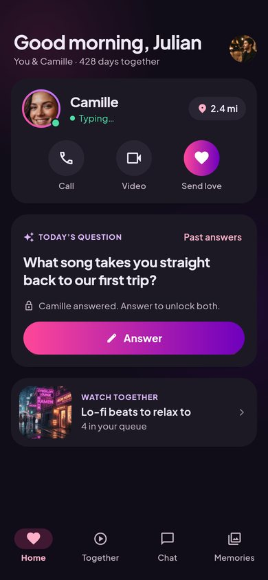 | 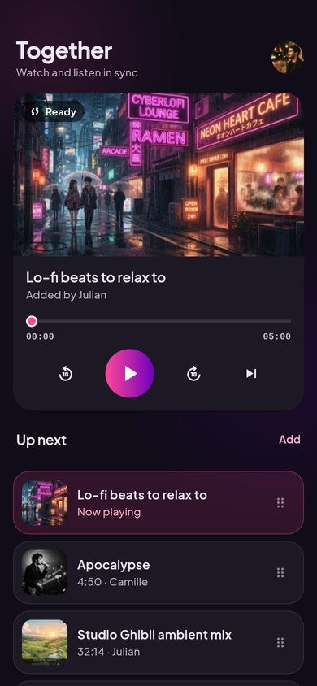 | 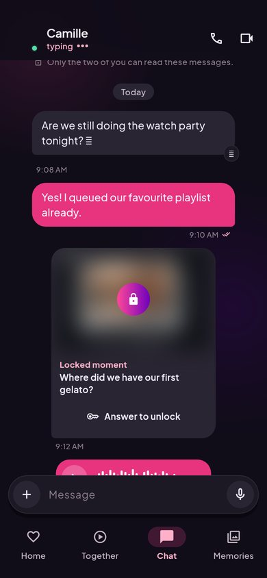 | 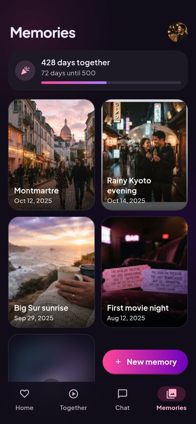 | 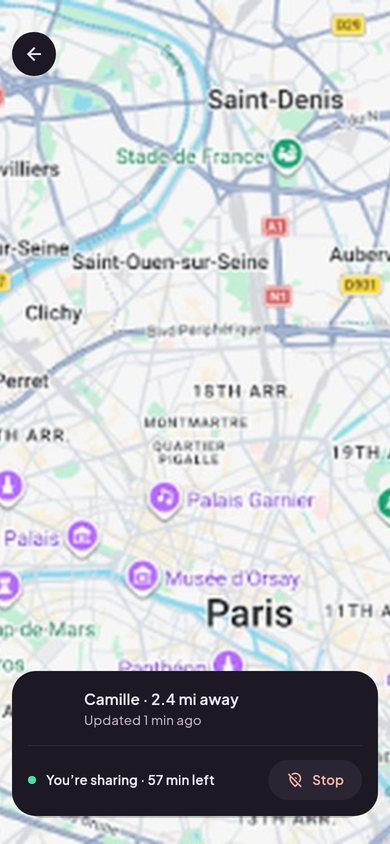 |
| **Light** | 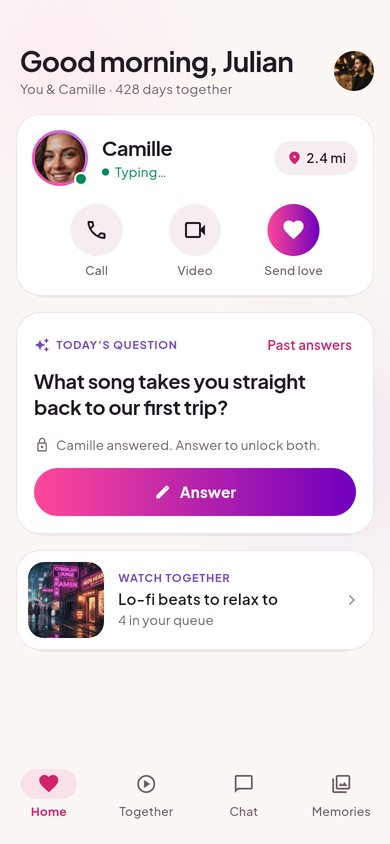 | 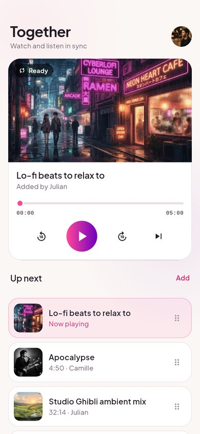 | 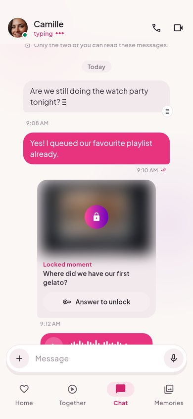 | 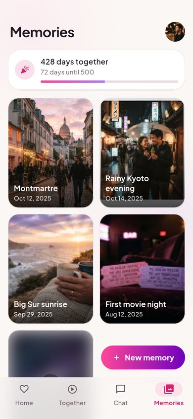 | 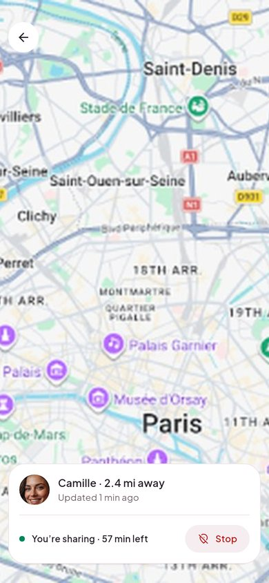 |

| Welcome | Pairing | Video call | Profile | Privacy |
|---|---|---|---|---|
| 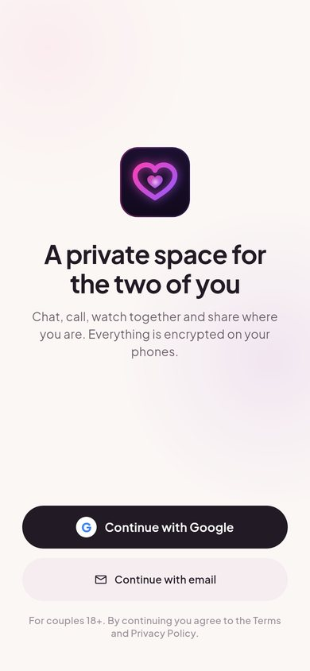 | 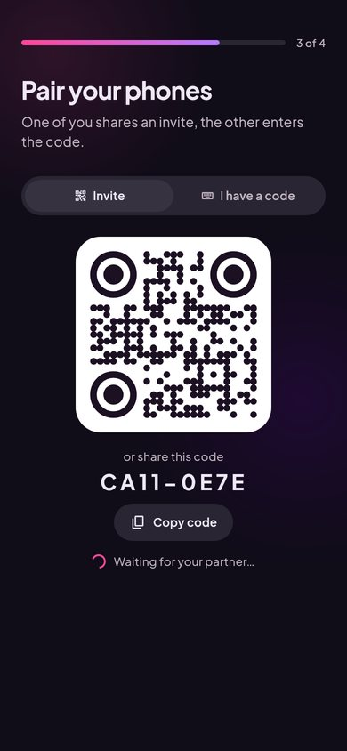 | 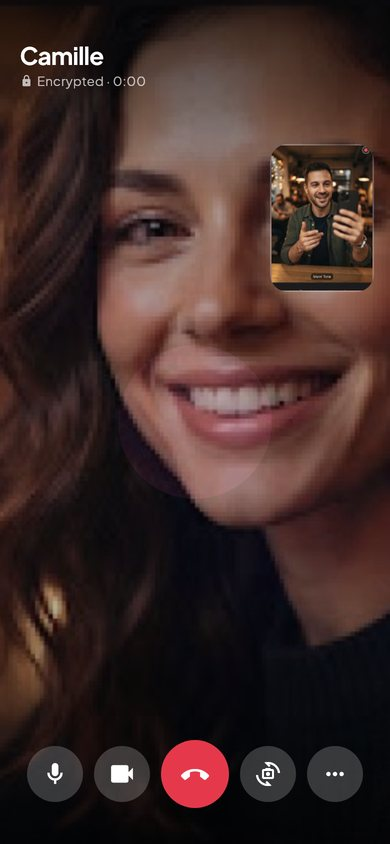 | 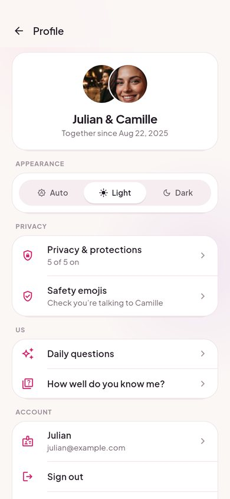 | 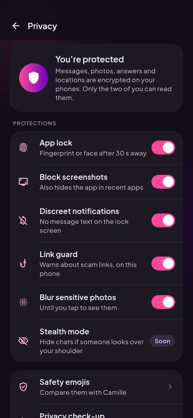 |

## Screens

| Where | What's on it |
|---|---|
| **Home** | Greeting, your partner (online / typing, distance, **Call · Video · Send love**), today's question, what's playing in Together |
| **Together** | One synced YouTube player, the shared queue (drag to reorder, swipe to remove), Playlists, Movie night (3-2-1 countdown on both phones) |
| **Chat** | End-to-end encrypted messages, photos, hold-to-record voice notes, hearts (double tap), read receipts, call buttons |
| **Memories** | Photo grid with a "days together" milestone; private memories open with your fingerprint |
| **Map** (from Home) | Both of you on a live map; share for 1 h / 8 h / until you stop, optionally approximate; one-tap stop |
| **Calls** | Voice or video, draggable self view, mute / camera / flip, Watch together inside the call, incoming-call screen |
| **Profile** | Theme (Auto / Light / Dark), Privacy, safety emojis, daily questions, sign out, unlink, delete account |
| **Privacy** | App lock, screenshot blocking, discreet notifications, link guard, photo blur, safety emojis, check-up |
| **Onboarding** | Welcome (Google or email) → your name → privacy promise → pair (QR or code) → compare safety emojis |

Coming after the beta (they open a small **Coming soon** pop-up): Spotify listening together, locked moments, GIFs, couple filters and screen sharing in calls, stealth mode, data export. "How well do you know me?" uses sample questions in the demo and is marked *Soon* when connected to a server.

## Demo or real backend

The app talks to a `Backend` interface (`lib/backend/backend.dart`) with two implementations:

- **Demo** (default): everything stays on the phone, with a simulated partner (Camille) who replies, joins your invite after a few seconds, and so on. The APKs in [`releases/`](../releases/) run in this mode unless they were built with Firebase settings.
- **Firebase**: real accounts, pairing, encrypted chat and media, presence, synced playback, daily questions, location, memories, push notifications and LiveKit calls. Set it up with [`backend/README.md`](../backend/README.md), then build with your settings:

  ```bash
  cp config/firebase.example.json config/firebase.json   # fill it in
  flutter run --dart-define-from-file=config/firebase.json
  ```

Private content is sealed on the phone before it's sent: X25519 key agreement, HKDF and XChaCha20-Poly1305 (`lib/core/crypto/`). The server only ever stores ciphertext. Profile → Safety emojis lets you check, in person, that nobody swapped a key.

## Run and build

```bash
cd app
flutter pub get
flutter run                                  # debug build on a phone or emulator
flutter build apk --release --split-per-abi  # release APKs in build/app/outputs/flutter-apk/
```

Requirements: Flutter 3.47 (stable), JDK 17 and the Android SDK (API 36). CI (`.github/workflows/android.yml`) runs analyze and tests, then builds the APKs. A manual run (**Actions → Android app → Run workflow**) also commits them to [`releases/`](../releases/).

## Smooth on 60 to 165 Hz screens

- `MainActivity` asks for the display's fastest refresh rate; Impeller renders.
- Every animation is time-based (fades, pops, theme changes), so it's equally fast and only smoother on faster panels.
- Glows are radial gradients, not blur passes; real blur is only on the bars.
- Hidden tabs stop their animations; the YouTube player pauses locally when you leave Together (your partner keeps watching).
- "Remove animations" in Android's accessibility settings is respected.

## Structure

```
lib/
  app/            app root, 4-tab shell, build-time config
  backend/        Backend interface, demo/ and firebase/ implementations, LiveKit calls
  core/
    crypto/       couple key, sealing, media encryption, safety emojis, key storage
    sync/         watch-together sync engine (drift, last-writer-wins)
    theme/        light + dark colour tokens, type scale, theme controller
    motion/       FadePop, Pressable, routes, pulses
    widgets/      cards, buttons, tiles, segmented control, sheets, dialogs
  data/           models and CoupleState (UI state over the backend)
  features/       home · together · chat · memories · map · call · profile · privacy · questions · onboarding
```

## Tests

```bash
flutter test                                                     # widget flows + crypto, sync and link unit tests
flutter test --run-skipped --tags screenshots --update-goldens   # renders every screen, both themes, to test/goldens/
```

The crypto tests include the RFC 7748 X25519 vectors and tamper checks.
