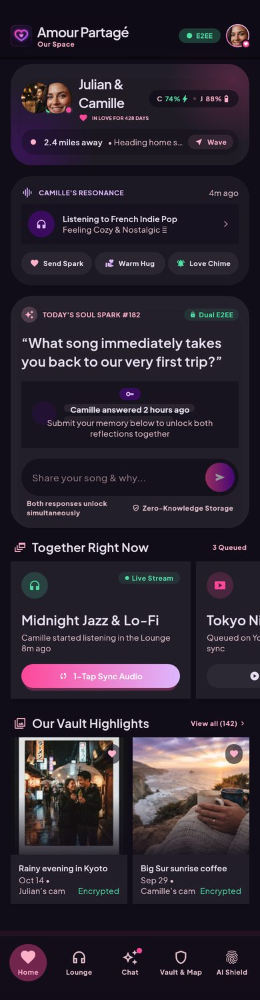
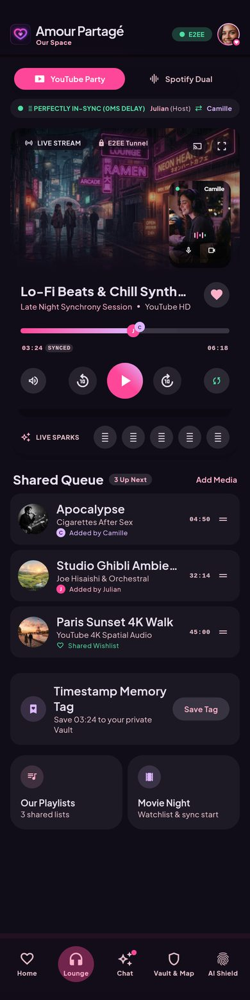
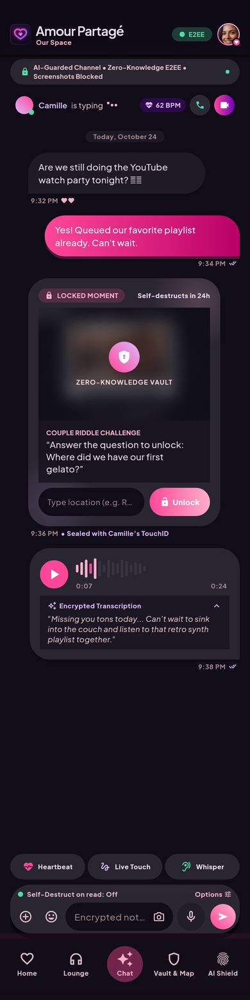
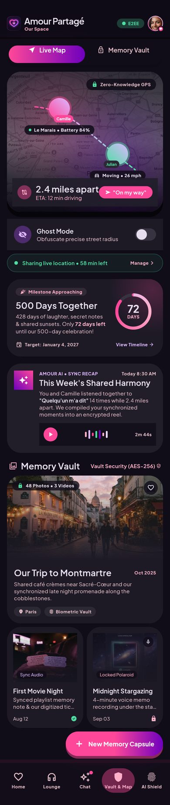
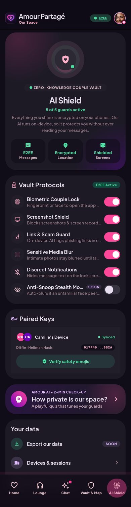
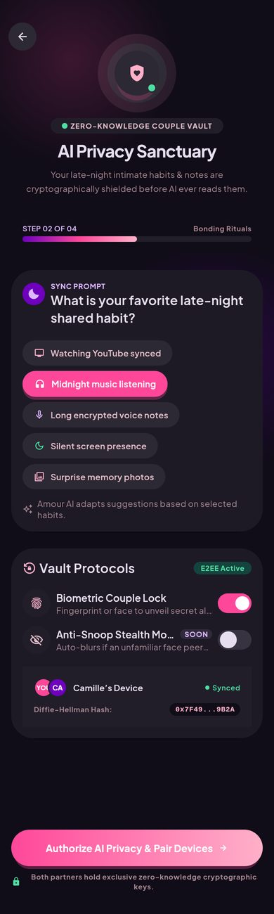
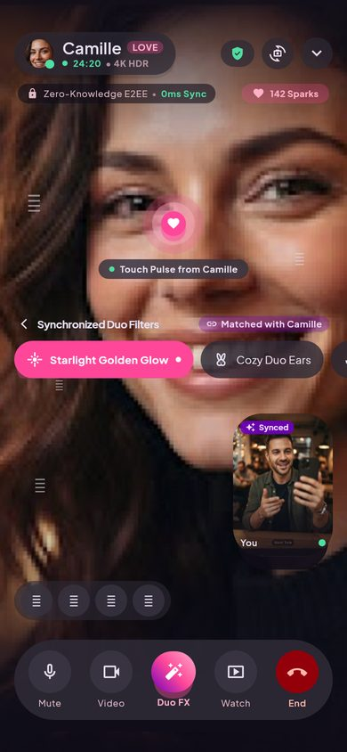
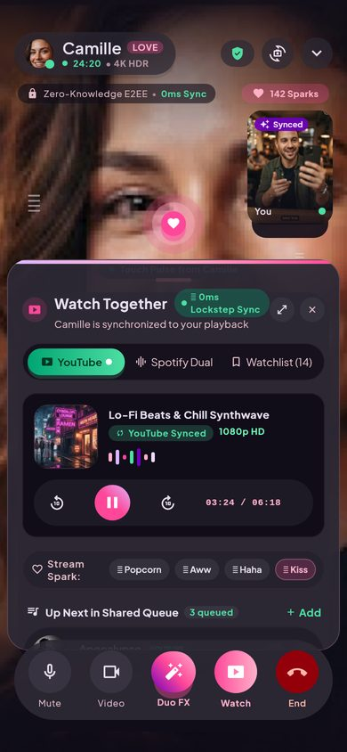
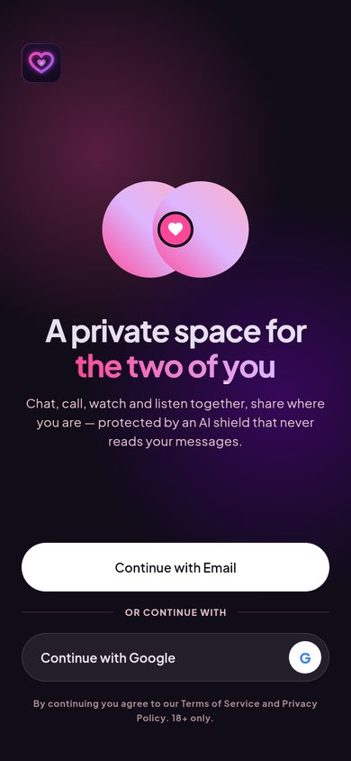

# Amour Partagé — Android app (Flutter)

The couples app frontend, built from the Figma theme. It is dark, glassy and pink/violet, set in Plus Jakarta Sans with Material Symbols icons.

| Home | Lounge | Chat | Vault & Map | AI Shield |
|---|---|---|---|---|
|  |  |  |  |  |

| Onboarding · step 2 | Video call | Watch Together on a call | Welcome |
|---|---|---|---|
|  |  |  |  |

## Run it

```bash
cd app
flutter pub get
flutter run                                  # debug build on a connected phone or emulator
flutter build apk --release --split-per-abi  # release APKs in build/app/outputs/flutter-apk/
```

Requirements: Flutter 3.47 (stable), JDK 17 and the Android SDK (API 36).
CI (`.github/workflows/android.yml`) runs analyze and tests, then builds the APKs on every push that touches `app/`.
A manual run (**Actions → Android app → Run workflow**) also commits the APKs to [`releases/`](../releases/).

## Speed and smoothness (60 → 165 Hz)

- **Full refresh rate.** `MainActivity` requests the display's fastest mode (90/120/144/165 Hz). Many phones otherwise hold apps at 60 Hz.
- **Impeller renderer** is enabled explicitly (Vulkan, with GLES fallback).
- **Every animation is time-based.** Fades, pops, springs and page transitions run on the vsync ticker, so they stay at the same speed and look smoother on faster panels.
- **Cheap effects.**
  - Card "glows" are radial gradients, not blur passes.
  - Real backdrop blur is used only on the header and nav (grouped with `BackdropGroup`).
  - Hidden tabs are offstage with their tickers paused.
  - Images decode at display size.
  - Live indicators ping and then rest, so idle screens stop redrawing.
- **Respects "Remove animations"** in Android accessibility settings.

## Screens

| Area | Screens |
|---|---|
| Onboarding | Splash · Welcome (email magic link / Google) · Step 1 *About us* · Step 2 *AI Privacy Sanctuary* (Figma) · Step 3 *Pair phones* (QR + invite code) · Step 4 *Safety emoji check* |
| Home (Figma) | Couple hub · partner presence · Send Spark / Warm Hug / Love Chime · daily Soul Spark with simultaneous reveal · Together Right Now · Vault highlights |
| Lounge (Figma) | YouTube Party synced player · partner PiP · shared scrubber · Live Sparks · drag-to-reorder / swipe-to-remove queue · timestamp memory tag · full-screen player · Add media sheet · Playlists · Movie Night with synced 3-2-1 start |
| Chat (Figma) | E2EE chat · typing indicator · locked moment with riddle unlock · voice notes (hold the mic) · photos (system photo picker) · emoji / attach / options sheets · Heartbeat |
| Calls (Figma) | Outgoing ringing → connected video call · draggable self-view · touch pulse (double-tap) · love reactions · mute / camera · Watch Together drawer · voice-only mode · incoming call |
| Vault & Map (Figma) | Live map with partner pins · Ghost Mode · time-boxed location sharing · 500-days milestone ring · AI recap · Memory Vault (biometric unlock) · New capsule · Timeline |
| AI Shield | Guard toggles · paired keys + safety emojis · privacy check-up quiz · data / unlink |
| More | Profile & settings · Soul Sparks archive · couple quiz · app lock |

## Beta vs. coming soon

Features scheduled after beta hardening open a **"Coming soon"** pop-up when tapped:

- Spotify Dual sync
- Cast to TV
- Duo FX AR filters
- Anti-Snoop Stealth Mode / Cloak
- Live Touch drawing
- Whisper mode
- Self-destruct messages
- Creating Locked Moments
- GIFs
- Message search
- Chat themes
- Binaural audio
- AI recap reels
- Time-locked capsules
- Spotify import
- Data export
- QR scanner
- Light theme

### Real now (on-device)

- **Screenshot Shield:** `FLAG_SECURE` through a platform channel, on by default.
- **Biometric Couple Lock:** the app locks after 30 s in the background.
- **Vault unlock:** uses the system biometric prompt (`local_auth`).
- **Photo picking:** the system photo picker and camera (`image_picker`).
- **Pairing QR code:** a real QR code (`qr_flutter`).

### Demo data until the backend is connected

- Messages, the queue, location and calls are local mock state (`lib/data/`).
- Demo photos live in `assets/demo/` and are swapped for the couple's own encrypted media later.

## Structure

```
lib/
  app/            app root, shell (header, nav, tab fade-through)
  core/
    motion/       FadePop, Pressable, PingDot/Breathing, routes
    theme/        colour + type tokens from Figma
    widgets/      cards, pills, buttons, avatar, switch, sheets, coming-soon, logo
    security/     biometric + privacy channel
  data/           models, mock data, CoupleState (AppScope)
  features/       onboarding · home · lounge · chat · call · vault · shield · questions · profile
android/          MainActivity (high refresh, FLAG_SECURE), themes, adaptive icon, splash
tool/brand/       launcher icon / splash generators
```

## Tests

```bash
flutter test                                                            # smoke tests (tabs, chat, Soul Spark, coming-soon, onboarding, call)
flutter test --run-skipped --tags screenshots --update-goldens          # renders every screen to test/goldens/
```
